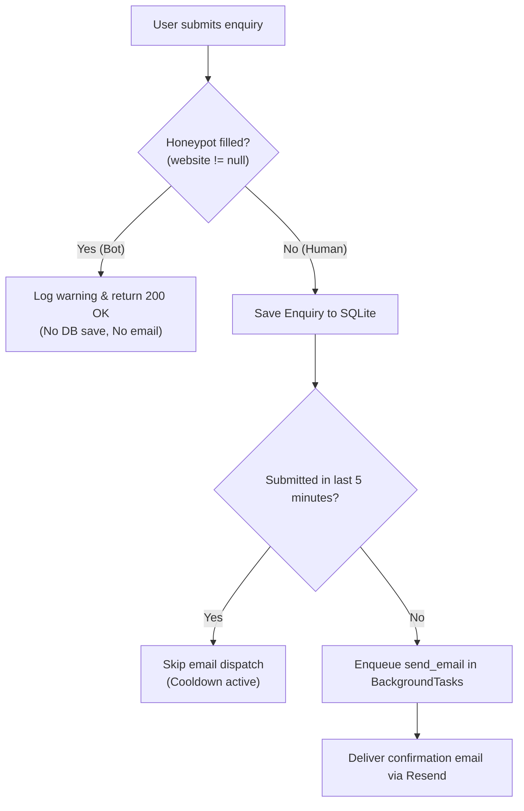

# Enquiry Automation

A fast, production-ready enquiry intake and auto-responder service built with **FastAPI**, **SQLAlchemy**, and the **Resend API**, featuring multi-layered spam defense and automated CI testing.

---

## ✨ Features

- **Responsive Landing Page**: Clean, modern contact interface ("Northstar") served directly from FastAPI static files.
- **Instant Response with Background Tasks**: Enquiries are saved immediately, while confirmation emails are dispatched asynchronously in the background via FastAPI's `BackgroundTasks`.
- **Multi-Layered Spam Protection**:
  - **Honeypot Trap**: Invisible field in HTML traps automated web scrapers and drops them with zero database writes or email dispatches.
  - **Database Cooldown**: 5-minute cooldown query prevents repeat confirmation emails if the same email address submits multiple messages in quick succession.
- **SQLAlchemy & SQLite**: Lightweight, zero-config relational storage for incoming enquiries with timestamps and UUID primary keys.
- **Automated Test Suite**: Full `pytest` integration using in-memory SQLite and mocked email calls to ensure reliable test runs without consuming external API credits.
- **CI/CD with GitHub Actions**: Automated pipeline using `uv` and Python 3.14 that runs all unit and integration tests on every push.

---

## 🛠️ Tech Stack

- **Runtime & Package Manager**: Python `>=3.14`, [`uv`](https://github.com/astral-sh/uv)
- **Backend Framework**: [FastAPI](https://fastapi.tiangolo.com/)
- **Database & ORM**: SQLite, [SQLAlchemy 2.0](https://www.sqlalchemy.org/)
- **Email Service**: [Resend Python SDK](https://resend.com/)
- **Testing**: `pytest`, `httpx` (`TestClient`)
- **CI/CD**: GitHub Actions

---

## 📁 Project Structure

```
enquiry-automation/
├── .github/
│   └── workflows/
│       └── ci.yml               # GitHub Actions CI pipeline
├── src/
│   ├── templates/
│   │   ├── Index.html           # Contact form markup with honeypot
│   │   ├── Style.css            # Responsive styling
│   │   ├── app.js               # Form submission handling
│   │   ├── admin.html           # Minimalist monospace admin dashboard
│   │   ├── admin.css            # Monospace dashboard styling (#3F88C5)
│   │   └── admin.js             # Dashboard dynamic fetching & audit timeline
│   └── enquiry_automation/
│       ├── apis/
│       │   └── resendEmailApi.py # Resend email delivery integration
│       ├── database/
│       │   ├── connection.py    # Database engine and session dependency
│       │   ├── crud.py          # Database operations and query helpers
│       │   └── models.py        # SQLAlchemy Enquiry & EnquiryLog models
│       ├── schemas.py           # Pydantic request & response models
│       └── main.py              # FastAPI app, endpoints, and background worker
├── tests/
│   ├── conftest.py              # In-memory SQLite fixtures & DB overrides
│   ├── test_admin.py            # Admin authentication and query tests
│   └── test_enquiries.py        # Enquiry, honeypot & cooldown tests
├── pyproject.toml               # Project metadata & dependencies
├── uv.lock                      # Locked dependency tree
└── README.md
```

---

## 🚀 Getting Started

### 1. Prerequisites

Make sure you have [uv](https://docs.astral.sh/uv/) installed:
```bash
curl -LsSf https://astral.sh/uv/install.sh | sh
```

### 2. Clone the Repository

```bash
git clone https://github.com/coolbams/Enquiry-automation.git
cd Enquiry-automation
```

### 3. Environment Variables

Create a `.env` file in the root directory:
```bash
RESEND_API_KEY=re_your_api_key_here
```

### 4. Install Dependencies

Install project dependencies into a virtual environment with `uv`:
```bash
uv sync
```

### 5. Run the Server

Start the FastAPI development server:
```bash
uv run fastapi dev src/enquiry_automation/main.py
```
Or with Uvicorn:
```bash
uv run uvicorn src.enquiry_automation.main:app --reload
```

The app will be available at:
- **Webpage**: [http://localhost:8000](http://localhost:8000)
- **Interactive API Docs (Swagger)**: [http://localhost:8000/docs](http://localhost:8000/docs)

---

## 🧪 Running Tests

The test suite runs against an isolated, in-memory SQLite database and mocks the Resend email API so no live emails are sent:

```bash
uv run pytest
```

---

## 📡 API Endpoints

### `GET /`
Serves the contact form HTML.

### `POST /enquiries`
Accepts a new enquiry submission.

#### Request Body
```json
{
  "name": "Jane Doe",
  "email": "jane@example.com",
  "message": "We would like to discuss a project with your team.",
  "website": null
}
```

> **Note**: `website` is the hidden honeypot field. Legitimate users submit `null` or empty string. If filled, the request is silently dropped without saving to the database.

#### Response (`200 OK`)
```json
{
  "message": "Enquiry received successfully"
}
```

---

## 🛡️ Anti-Spam Architecture



---

## 👤 Author

- **Sam** ([@coolbams](https://github.com/coolbams)) - *oyerindesamuel207@gmail.com*
